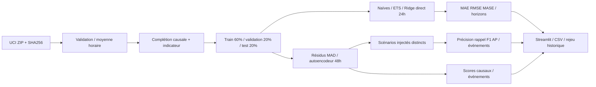

# Détection d’anomalies et prévision de séries temporelles

Projet portfolio CPU : puissance électrique réelle UCI, prévision horaire à 24h,
détecteur robuste et autoencodeur PyTorch, démonstration Streamlit en français.
Les alertes réelles sont des comportements suspects, **pas des anomalies annotées**.

## Démarrage Windows PowerShell

Depuis le dossier contenant ce README, avec Python 3.13 :

```powershell
py -3.13 -m venv .venv
.\.venv\Scripts\python.exe -m pip install -r requirements.lock.txt
.\.venv\Scripts\python.exe run.py --mode quick
.\.venv\Scripts\python.exe -m pytest -q
.\.venv\Scripts\python.exe -m ruff check .
.\.venv\Scripts\python.exe -m streamlit run app.py
```

Les modèles livrés permettent de sauter `run.py` pour ouvrir directement la démo.
L’environnement de construction local se trouve dans `../../work/.venv`.

## Linux

```bash
python3.13 -m venv .venv
.venv/bin/python -m pip install torch==2.14.1 --index-url https://download.pytorch.org/whl/cpu
.venv/bin/python -m pip install -r requirements.lock.txt
.venv/bin/python run.py --mode quick
.venv/bin/python -m pytest -q
.venv/bin/python -m ruff check .
.venv/bin/python -m streamlit run app.py
```

`python run.py --mode full` utilise tout l’historique, 40 époques et 100 origines test.
Le mode rapide utilise 2009, 12 époques et 28 origines test. L’acquisition reste complète
pour conserver une empreinte du fichier source. Aucun GPU ni service payant requis.
Les commandes Linux sont fournies pour reproduction ; voir le rapport pour les
vérifications effectivement exécutées sous Windows.

## Commandes et livrables

`run.py` orchestre acquisition, préparation, sélection sur validation, entraînement,
évaluation originale/synthétique et rechargement. Les modules `energy/data.py`,
`forecast.py`, `anomalies.py`, `evaluation.py` séparent les responsabilités.

Pour exécuter les étapes séparément : `python prepare.py --acquire-only`,
`python prepare.py`, `python run.py --mode quick`, puis
`python evaluate.py --mode quick`. La dernière commande recharge les artefacts
figés et vérifie que les métriques recalculées sont identiques.
`python report.py` régénère le rapport à partir des résultats sauvegardés.

```powershell
.\.venv\Scripts\python.exe infer.py artifacts/quick/series.csv --output inference
```

CSV d’import : `timestamp,power_kw`, dates ISO locales sans fuseau, intervalle exact
d’une heure, puissance moyenne en kW, au moins 49 observations pour les alertes et
168 pour la prévision. Les valeurs manquantes sont propagées depuis le passé ; une
première valeur manquante est refusée. Les doublons, valeurs infinies ou négatives
sont refusés. La colonne ne peut pas prouver l’unité physique : l’interface demande
sa confirmation. Un nouveau compteur reste hors du domaine validé.

Les sorties comprennent modèles, données préparées, prédictions, métriques par
horizon et week-end, scores, événements, scénarios injectés, positions et graines,
historique de perte et graphiques HTML interactifs dans `artifacts/quick`.
`examples/import.csv` contient 200 heures originales de fin 2009 pour l’import,
et `examples/exports` contient des exports effectivement générés par `infer.py`.
Ne charger que les fichiers pickle générés localement ou obtenus d’une source fiable.

Voir [la fiche dataset](docs/DATASET.md), [les méthodes](docs/METHODES.md),
[la démonstration](docs/DEMO.md) et [le rapport mesuré](docs/RAPPORT.md).

## Architecture



## Publication GitHub

Dépôt public : [AdnaneEDr/electricity-forecasting-anomaly-detection](https://github.com/AdnaneEDr/electricity-forecasting-anomaly-detection).
Le workflow `.github/workflows/ci.yml` est à la racine du dépôt. Le ZIP brut et le CSV complet sont
ignorés ; leur téléchargement reproductible reste disponible. Les données dérivées
doivent conserver l’attribution UCI CC BY 4.0. Le code original est sous licence MIT.
La CI réalise lint et tests, sans téléchargement ni entraînement complet.
